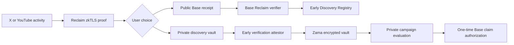

# Early V2 Handoff

Last updated: 2026-07-23

Workspace: `/Users/xiaomao/Earlyy`

Current branch: `feature/landing-redesign`

## Start Here: The New Chat's First Task

Do not begin with another redesign, architecture brainstorm, or code rewrite.
The first task is to help Nelly deploy the current V2 implementation and test
the real X flow from beginning to end.

Nelly's request, preserved in full:

> Now give me instructions to deploy. I think I have a deployer wallet, but I
> do not remember the alias, so give me commands. I have an Alchemy RPC URL.
> For verifying contracts on Etherscan, I heard that Etherscan removed support
> for Base, or something changed, so explain that accurately. Give me all the
> instructions to deploy. Then we will test from start to end whether the app
> works as expected: open the website, paste an X link, complete Reclaim, and
> continue until the Base receipt is finalized. Give me everything I need to do
> in Supabase and tell me exactly what information or public output you need
> from me. I will run the commands in my terminal and paste the outputs.

Important working preference:

- Nelly wants to run commands herself and paste their outputs.
- Give commands in small, ordered batches and wait for the output after each
  risky or state-changing batch.
- Never ask her to paste a private key, mnemonic, RPC URL, API key, wallet
  password, Privy secret, Reclaim secret, Supabase service-role key, encryption
  key, or service token.
- Ask only for public addresses, chain IDs, balances, transaction hashes,
  deployment JSON, non-secret configuration IDs, and exact error messages.
- Explain what each command is checking. Do not dump commands without context.

## Immediate Deployment Strategy

Deploy and test in two explicit rounds:

1. **Public path now:** Privy login -> X URL -> Reclaim zkTLS proof -> atomic
   verification and receipt registration on Base Sepolia -> Supabase
   reconciliation -> Basescan link.
2. **Private path later:** verified proof -> Early attestor -> Zama encrypted
   vault on Ethereum Sepolia -> private campaign evaluation -> bridge-signed,
   one-time Base eligibility authorization.

The public Base path has application and contract code in this repository and
is the first end-to-end target.

The private Zama path is not production-end-to-end merely because its contract
can be deployed. It also requires deployable external attestor and bridge
services, separately scoped signer keys, a trusted relayer, and Zama gateway
integration. Do not represent it as live until those services exist.

## Product

**Early** is proof-of-discovery for the internet.

Core line:

> Being early used to be a story. Now it is proof.

Early lets someone prove that they genuinely found and supported a creator,
post, song, video, project, or community before the crowd arrived. It is not
mainly a prediction market for what will go viral. It is about making early
participation verifiable so it can become cultural reputation, creator
recognition, campaign eligibility, access, loyalty, or a simple permanent
receipt.

The first production proof is X:

- the user pastes the URL of the original public X post;
- the authenticated X account must have both liked and replied to that post;
- the reply must be tied to that focal post;
- Early verifies those facts through Reclaim rather than trusting a screenshot.

X is a demonstration platform, not the full company. Planned provider surfaces
include YouTube, GitHub, Spotify, Instagram, and other cultural platforms.
YouTube is the next provider target. GitHub was discussed as a useful second
proof of the provider/infrastructure model after YouTube.

Primary audience:

- internet tastemakers and early fans first;
- creators and brands second;
- developers integrating Early providers, schemas, and receipts third.

Longer-term infrastructure opportunity:

- reusable, versioned Reclaim providers;
- normalized verified-discovery schemas;
- a public receipt registry;
- private campaign eligibility primitives;
- SDKs and APIs that let other products consume verified discovery without
  rebuilding every provider.

## Why V2 Exists

V1 was built for the Stellar ZK Hackathon. It worked end to end:

- Reclaim zkTLS proof;
- Stellar Reclaim verifier;
- Stellar receipt contract;
- five real receipt events;
- no raw social identity stored in receipt state.

Historical Stellar testnet contracts:

- Reclaim verifier:
  `CA3EMXR6JOOTNP44T3OAJFMMMGKRRETDJKBLZP2RU3SIY4SDFAH54DU5`
- Early receipt:
  `CDBE7NFQPVD5LXU7TJVQTXZNBYIH75VXQW24DA7LARS3MA5XLT2V2VRM`

The project did not win the hackathon. The useful judge feedback was:

- the zkTLS-to-chain bridge was creative;
- the receipt contract was clean;
- `publish_receipt` did not enforce the verifier result on-chain;
- verification lived in the frontend and Supabase, so a caller could bypass
  it and call the receipt contract directly;
- the Reclaim verifier source was not committed;
- integration tests, a license, and a longer end-to-end demo were missing.

V2 directly addresses the main security issue:

- there is no separate public `publishReceipt` function;
- `EarlyDiscoveryRegistry.verifyAndRegister` calls the Reclaim verifier and
  creates the receipt in the same Base transaction;
- invalid or missing proofs cannot take a second publishing path.

Stellar is now historical reference only. It is preserved under
`archive/stellar-v1` and removed from the active app, dependencies, environment,
routes, and README narrative.

Do not delete the archive and do not revive Stellar in the active UI unless
Nelly explicitly changes direction.

## V2 Architecture



### Public Base Receipt

Contract:
`contracts/base/src/EarlyDiscoveryRegistry.sol`

Entry point:
`verifyAndRegister(ReclaimTypes.Proof proof)`

Security invariants:

- calls the configured Reclaim verifier first;
- validates `contextAddress` against `msg.sender`;
- validates the signed claim owner against `msg.sender`;
- accepts only allowlisted provider-configuration hashes;
- checks schema version and platform;
- X requires `liked`, `replied`, `replyId`, `replyToSubjectId`, and
  `replyTimestamp`;
- the reply-to subject must equal the focal post;
- rejects duplicate proof IDs, session nullifiers, and receipt commitments;
- can be paused in an emergency;
- provider administration is owner-controlled;
- the verifier address is immutable.

Receipt state stores only:

- owner wallet;
- proof ID;
- platform hash;
- subject hash;
- content hash;
- provider hash;
- verification time.

Selected Reclaim proof fields still appear in public transaction calldata.
The UI must say this honestly.

Base Sepolia Reclaim verifier:
`0xF90085f5Fd1a3bEb8678623409b3811eCeC5f6A5`

Base mainnet Reclaim verifier for a future deployment:
`0x8CDc031d5B7F148ab0435028B16c682c469CEfC3`

Deployment output:
`contracts/base/deployments/base-sepolia.json`

Addresses are currently placeholders until deployment succeeds.

### Base Campaign Claims

Contract:
`contracts/base/src/CampaignClaims.sol`

This contract creates campaign windows and consumes EIP-712
`EligibilityAuthorization` messages. It emits eligibility-claim events but does
not distribute tokens or NFTs in V2.

The bridge signer can be rotated with `setBridgeSigner`. For the first public
receipt deployment only, the deployer may temporarily be used as bridge signer
on testnet. Replace it before claiming that private campaigns are live.

### Confidential Zama Vault

Contract:
`contracts/zama-private-receipt/contracts/EarlyPrivateDiscoveryVault.sol`

Network:
Ethereum Sepolia, using Zama FHEVM host/gateway infrastructure.

The V2 contract replaces the old one-off private tier contract. It stores
encrypted earliest-discovery timing, qualifying interaction count, and
eligibility-related state under an opaque vault ID.

It does not accept an arbitrary encrypted delta directly from the user. A
trusted Early attestor must:

1. verify the Reclaim proof;
2. derive the exact allowed plaintext input;
3. encrypt it for the Zama contract;
4. sign an EIP-712 attestation binding the ciphertext, owner binding, proof
   commitment, subject, nonce, expiry, chain, and contract.

The contract verifies that attestation and rejects modified ciphertext,
duplicate commitments, and consumed nonces.

Honest V2 privacy boundary:

- the Early attestor sees the verified plaintext before encryption;
- creators, brands, and public observers do not;
- FHE protects accumulated history and campaign computation;
- only final eligibility should be revealed;
- this is a practical hybrid trust model, not yet a trustless proof directly
  binding Reclaim output to FHE ciphertext.

External services still required:

- `EARLY_ATTESTOR_SERVICE_URL`
- `EARLY_ATTESTOR_SERVICE_TOKEN`
- `EARLY_BRIDGE_SERVICE_URL`
- `EARLY_BRIDGE_SERVICE_TOKEN`
- managed, separately scoped attestor and bridge signer keys;
- a trusted relayer address;
- Zama relayer/gateway access.

The Next.js app intentionally has no raw private-key fallback for those
services.

## Active Application Flow

Relevant routes:

- `/` - landing page
- `/proof` - proof console
- `/vault` - opaque private artifacts
- `/campaigns` - creator/brand campaign workspace
- `/developers` - schemas, integration model, and contract information

Proof APIs:

- `POST /api/reclaim/start`
- `POST /api/reclaim/callback`
- `GET /api/reclaim/session/[sessionId]`
- `POST /api/base/receipt/prepare`
- `POST /api/base/receipt/submit`
- `POST /api/vault/attestation`
- `POST /api/internal/retention`

Campaign APIs:

- `GET /api/campaigns`
- `POST /api/campaigns/prepare`
- `POST /api/campaigns/register`
- `POST /api/campaigns/evaluate`
- `POST /api/campaigns/claim/submit`

Public receipt flow:

1. Privy authenticates the user and supplies an embedded or connected EVM
   wallet.
2. `/api/reclaim/start` validates the browser origin and confirms that the
   requested wallet is linked to the Privy account.
3. Reclaim context binds the proof to that wallet, platform, provider hash,
   schema version, subject, and session nullifier.
4. Reclaim calls the app callback.
5. The callback verifies and normalizes the proof, encrypts the raw proof, and
   records a verified session.
6. The browser asks `/api/base/receipt/prepare` for the on-chain proof.
7. The user's wallet calls `verifyAndRegister` on Base Sepolia.
8. `/api/base/receipt/submit` confirms the transaction target and exact
   `DiscoveryRegistered` event before storing the chain receipt and finalizing
   the session.

The user wallet, including a Privy embedded wallet, needs Base Sepolia ETH to
submit the receipt transaction.

## Proof Model

Normalized types live in `src/lib/proof-model.ts`:

- `VerifiedDiscovery`
- `PublicReceipt`
- `ConfidentialInputAttestation`
- `EligibilityAuthorization`

Commitments use EVM-native `keccak256` and domain separation containing
version, chain ID, and contract address.

Provider fixtures:

- `fixtures/providers/x-v2.json`
- `fixtures/providers/youtube-v2.json`

Provider hashes are versioned and must match between:

- the Reclaim request context;
- the normalized proof session;
- `.env.local`;
- the Base registry allowlist.

If the Base deploy omits the X provider hash, valid X proofs will still revert
with `ProviderNotAllowed`.

## Supabase

Migration:
`supabase/v2_verified_discovery.sql`

Tables:

- `proof_sessions_v2`
- `chain_receipts_v2`
- `vault_identities_v2`
- `confidential_inputs_v2`
- `campaigns_v2`
- `evaluations_v2`

V1 records are not overwritten.

RLS is enabled and there are no browser-facing PostgREST policies. The server
uses privileged credentials only after Privy ownership checks.

Raw Reclaim proofs:

- are encrypted with AES-256-GCM before storage;
- use `RAW_PROOF_ENCRYPTION_KEY`;
- expire after `RAW_PROOF_RETENTION_HOURS`, default 24;
- are removed when a public receipt or private artifact finalizes;
- can also be cleaned by `POST /api/internal/retention` using
  `RETENTION_CRON_SECRET`.

Current compatibility note:

`src/lib/v2-store.ts` sends the Supabase key in both `apikey` and
`Authorization: Bearer` headers. Use the legacy `service_role` JWT for this
first deployment. Supabase's newer `sb_secret_*` keys are not JWTs and require
a small client change before using them here.

Never expose the service-role key as `NEXT_PUBLIC_*`.

## Environment Variables

Canonical list:
`.env.example`

Public Base path requires:

```text
RECLAIM_APP_ID
RECLAIM_APP_SECRET
RECLAIM_REQUIRE_TEE_ATTESTATION
RECLAIM_X_PROVIDER_ID
RECLAIM_X_PROVIDER_VERSION
RECLAIM_X_PROVIDER_CONFIGURATION_HASH

NEXT_PUBLIC_PRIVY_APP_ID
PRIVY_APP_ID
PRIVY_APP_SECRET
PRIVY_JWT_VERIFICATION_KEY

NEXT_PUBLIC_APP_URL
ALLOWED_APP_ORIGINS
RAW_PROOF_ENCRYPTION_KEY
RAW_PROOF_RETENTION_HOURS
RETENTION_CRON_SECRET

SUPABASE_URL
SUPABASE_SERVICE_ROLE_KEY

NEXT_PUBLIC_BASE_CHAIN_ID
NEXT_PUBLIC_BASE_REGISTRY_ADDRESS
NEXT_PUBLIC_BASE_CAMPAIGN_CLAIMS_ADDRESS
NEXT_PUBLIC_BASE_EXPLORER_URL
BASE_RPC_URL
```

Private Zama path additionally requires:

```text
NEXT_PUBLIC_ZAMA_CHAIN_ID
NEXT_PUBLIC_ZAMA_VAULT_ADDRESS
NEXT_PUBLIC_ZAMA_RELAYER_URL
NEXT_PUBLIC_ZAMA_EXPLORER_URL
ZAMA_RELAYER_UPSTREAM_URL
ZAMA_RELAYER_API_KEY
ZAMA_RPC_URL

EARLY_ATTESTOR_KMS_KEY_ID
EARLY_BRIDGE_KMS_KEY_ID
EARLY_ATTESTOR_SERVICE_URL
EARLY_ATTESTOR_SERVICE_TOKEN
EARLY_BRIDGE_SERVICE_URL
EARLY_BRIDGE_SERVICE_TOKEN
```

One Alchemy URL is not enough for both networks:

- Base Sepolia RPC must report chain ID `84532`;
- Ethereum Sepolia RPC must report chain ID `11155111`.

`NEXT_PUBLIC_APP_URL` must be the exact reachable application origin. Reclaim
cannot call a callback on Nelly's laptop through `localhost`. Use a deployed
HTTPS URL or a stable HTTPS tunnel for end-to-end testing.

The same exact production or preview origin must be present in:

- `NEXT_PUBLIC_APP_URL`;
- `ALLOWED_APP_ORIGINS`;
- Privy's allowed origins;
- the browser URL used for the test.

If a Vercel preview is protected, Reclaim callbacks may receive HTTP 401.
Disable preview protection for the test or configure an intentional bypass.

## Deployment Runbook

The new chat should guide Nelly through these phases and wait for output after
each phase.

### Phase 0: Preserve a Reproducible Source State

The working tree currently contains the whole V2 migration as uncommitted
changes. Run:

```bash
cd /Users/xiaomao/Earlyy
git branch --show-current
git status --short
```

Do not revert any existing changes. They are intentional V2 work.

Before deployment, create logical commits so deployed bytecode corresponds to
a commit SHA.

Do not commit these local design/context files unless Nelly later asks:

- `.codex/`
- `DESIGN.md`
- `PRODUCT.md`
- `public/early-brand-board.png`
- `public/early-day-one-stage.jpg`
- `public/early-day-one-stage.png`

Nelly prefers logical commits, not `git add .` followed by one giant commit.

The deployment output JSON should be committed separately after deployment and
source verification.

### Phase 1: Find the Foundry Wallet Alias

```bash
cast wallet list
```

Then:

```bash
export DEPLOYER_ALIAS="the-alias-from-cast-wallet-list"
export DEPLOYER_ADDRESS="$(cast wallet address --account "$DEPLOYER_ALIAS")"
echo "$DEPLOYER_ADDRESS"
```

If no account exists, import the existing testnet deployer interactively:

```bash
cast wallet import early-base-deployer --interactive
```

Never put the raw deployer key in `.env.local`.

### Phase 2: Confirm the Base RPC and Funds

Put the Alchemy Base Sepolia URL in `.env.local` as `BASE_RPC_URL`, then:

```bash
export BASE_RPC_URL="$(node --env-file=.env.local -p 'process.env.BASE_RPC_URL')"
cast chain-id --rpc-url "$BASE_RPC_URL"
cast balance "$DEPLOYER_ADDRESS" --rpc-url "$BASE_RPC_URL" --ether
```

Expected chain ID:
`84532`

If the wallet has no test ETH, use an official Base Sepolia faucet. Do not send
mainnet ETH.

### Phase 3: Apply the Supabase Migration

Create or select the Early Supabase project.

On macOS:

```bash
pbcopy < supabase/v2_verified_discovery.sql
```

Paste it into Supabase SQL Editor and run it.

Confirm:

```sql
select table_name
from information_schema.tables
where table_schema = 'public'
  and table_name like '%_v2'
order by table_name;
```

Expected:

```text
campaigns_v2
chain_receipts_v2
confidential_inputs_v2
evaluations_v2
proof_sessions_v2
vault_identities_v2
```

Add the project URL and legacy service-role JWT to `.env.local`. Ask Nelly only
to confirm that they are set, never to paste the key.

### Phase 4: Configure Privy, Reclaim, and Application Security

Privy:

- enable email, Google, X/Twitter, and wallet login;
- enable embedded EVM wallets for users without wallets;
- allow `http://localhost:3000` for local UI work;
- allow the exact public HTTPS app origin for the end-to-end test;
- obtain the app ID, server app ID, app secret, and JWT verification key.

Reclaim:

- use the Early application ID and secret;
- use the existing X provider;
- ensure its resolved version equals `RECLAIM_X_PROVIDER_VERSION`;
- ensure it returns the X V2 fields expected by the contract;
- prefer the mobile Reclaim verifier if X rate-limits the portal login.

Generate local secrets:

```bash
openssl rand -base64 32
openssl rand -hex 32
```

Use the first for `RAW_PROOF_ENCRYPTION_KEY` and the second for
`RETENTION_CRON_SECRET`.

Non-secret environment presence check:

```bash
node --env-file=.env.local -e 'for(const k of ["RECLAIM_APP_ID","RECLAIM_APP_SECRET","RECLAIM_X_PROVIDER_ID","RECLAIM_X_PROVIDER_VERSION","NEXT_PUBLIC_PRIVY_APP_ID","PRIVY_APP_ID","PRIVY_APP_SECRET","SUPABASE_URL","SUPABASE_SERVICE_ROLE_KEY","RAW_PROOF_ENCRYPTION_KEY","RETENTION_CRON_SECRET","BASE_RPC_URL"]) console.log(k+": "+(process.env[k]?"set":"MISSING"))'
```

Ask Nelly to paste only this `set`/`MISSING` output.

### Phase 5: Calculate and Freeze the X Provider Hash

If no explicit provider hash exists, calculate the same V2 hash the app uses:

```bash
node --env-file=.env.local --input-type=module -e 'import {AbiCoder,keccak256,toUtf8Bytes} from "ethers"; const c=AbiCoder.defaultAbiCoder(); console.log(keccak256(c.encode(["bytes32","string","string","string","uint16"],[keccak256(toUtf8Bytes("early.provider-configuration/v2")),"x",process.env.RECLAIM_X_PROVIDER_ID,process.env.RECLAIM_X_PROVIDER_VERSION||"1.0.0",2])))'
```

Store the resulting `0x` plus 64-hex-character value as:

```text
RECLAIM_X_PROVIDER_CONFIGURATION_HASH
```

The same value must be visible to the Base deployment script and Next.js app.

### Phase 6: Run Preflight Tests

```bash
pnpm install --frozen-lockfile
pnpm typecheck
pnpm test:app
pnpm test:base
pnpm test:zama
pnpm build
pnpm build:base
```

Last known implementation report said these passed, but they must be rerun
against the exact pre-deployment commit.

Do not deploy through a failed test or build.

### Phase 7: Deploy Base Sepolia

Deployment script:
`scripts/deploy-base.mjs`

It requires:

- `BASE_RPC_URL`;
- `BASE_DEPLOYER_PRIVATE_KEY`;
- `EARLY_BRIDGE_SIGNER_ADDRESS`;
- optional provider hashes.

It deploys:

- `EarlyDiscoveryRegistry`;
- allowlists configured X/YouTube provider hashes at schema version 2;
- `CampaignClaims`;
- writes `contracts/base/deployments/base-sepolia.json`.

The JavaScript deployer does not currently consume a Foundry alias directly.
For this testnet deployment, capture the decrypted key only in the child
process environment:

```bash
BASE_DEPLOYER_PRIVATE_KEY="$(cast wallet decrypt-keystore "$DEPLOYER_ALIAS")" \
EARLY_BRIDGE_SIGNER_ADDRESS="$DEPLOYER_ADDRESS" \
node --env-file=.env.local scripts/deploy-base.mjs
```

The deployer address is temporarily used as bridge signer for the first public
path deployment. This is testnet-only and can be rotated.

Then:

```bash
cat contracts/base/deployments/base-sepolia.json
```

Nelly may paste this JSON. It contains public addresses, not secrets.

### Phase 8: Verify Base Contracts

Base support was not removed.

What changed:

- Etherscan API V2 uses one Etherscan key across Etherscan-family explorers;
- old Basescan-specific API keys are deprecated;
- Etherscan's supported-chains table currently lists Base and Base Sepolia as
  unavailable on the general Free API tier;
- source-code and ABI endpoints are documented as available across plans;
- verification should first be attempted with an Etherscan V2 key;
- if the API plan rejects it, use Sourcify or manual explorer verification
  rather than buying a plan immediately.

Official references:

- https://docs.base.org/get-started/block-explorers
- https://docs.etherscan.io/supported-chains
- https://docs.etherscan.io/contract-verification/verify-with-foundry
- https://getfoundry.sh/forge/deploying

Prepare public deployment variables:

```bash
export DEPLOYMENT="contracts/base/deployments/base-sepolia.json"
export REGISTRY_ADDRESS="$(jq -r .earlyDiscoveryRegistry "$DEPLOYMENT")"
export CLAIMS_ADDRESS="$(jq -r .campaignClaims "$DEPLOYMENT")"
export RECLAIM_VERIFIER="$(jq -r .reclaimVerifier "$DEPLOYMENT")"
export OWNER_ADDRESS="$(jq -r .deployer "$DEPLOYMENT")"

read -s "ETHERSCAN_API_KEY?Etherscan V2 API key: "
export ETHERSCAN_API_KEY
echo
```

Verify the registry:

```bash
REGISTRY_ARGS="$(cast abi-encode 'constructor(address,address)' "$RECLAIM_VERIFIER" "$OWNER_ADDRESS")"

forge verify-contract --root contracts/base --chain 84532 --watch \
  --verifier etherscan \
  --etherscan-api-key "$ETHERSCAN_API_KEY" \
  --compiler-version v0.8.24+commit.e11b9ed9 \
  --num-of-optimizations 10000 --via-ir \
  --constructor-args "$REGISTRY_ARGS" \
  "$REGISTRY_ADDRESS" \
  src/EarlyDiscoveryRegistry.sol:EarlyDiscoveryRegistry
```

Verify campaign claims, assuming the temporary bridge signer is the owner:

```bash
CLAIMS_ARGS="$(cast abi-encode 'constructor(address,address)' "$OWNER_ADDRESS" "$OWNER_ADDRESS")"

forge verify-contract --root contracts/base --chain 84532 --watch \
  --verifier etherscan \
  --etherscan-api-key "$ETHERSCAN_API_KEY" \
  --compiler-version v0.8.24+commit.e11b9ed9 \
  --num-of-optimizations 10000 --via-ir \
  --constructor-args "$CLAIMS_ARGS" \
  "$CLAIMS_ADDRESS" \
  src/CampaignClaims.sol:CampaignClaims
```

If a separate bridge signer was used, the first constructor argument must be
that address instead of `OWNER_ADDRESS`.

If Etherscan returns a plan/network error, preserve the exact error and try:

```bash
forge verify-contract --root contracts/base --chain 84532 --watch \
  --verifier sourcify \
  --compiler-version v0.8.24+commit.e11b9ed9 \
  --num-of-optimizations 10000 --via-ir \
  --constructor-args "$REGISTRY_ARGS" \
  "$REGISTRY_ADDRESS" \
  src/EarlyDiscoveryRegistry.sol:EarlyDiscoveryRegistry
```

Do not claim Basescan verification unless the explorer actually shows the
verified source.

### Phase 9: Confirm Deployment State

```bash
cast code "$REGISTRY_ADDRESS" --rpc-url "$BASE_RPC_URL"
cast code "$CLAIMS_ADDRESS" --rpc-url "$BASE_RPC_URL"

cast call "$REGISTRY_ADDRESS" \
  "reclaimVerifier()(address)" \
  --rpc-url "$BASE_RPC_URL"

cast call "$REGISTRY_ADDRESS" \
  "providerConfigurations(bytes32)(bytes32,uint16,bool)" \
  "$RECLAIM_X_PROVIDER_CONFIGURATION_HASH" \
  --rpc-url "$BASE_RPC_URL"
```

Expected:

- both code results are not `0x`;
- verifier equals the official Base Sepolia Reclaim verifier;
- X provider configuration returns schema version `2` and `true`.

### Phase 10: Update and Deploy the Next.js App

Add the new public addresses:

```text
NEXT_PUBLIC_BASE_CHAIN_ID=84532
NEXT_PUBLIC_BASE_REGISTRY_ADDRESS=<deployed registry>
NEXT_PUBLIC_BASE_CAMPAIGN_CLAIMS_ADDRESS=<deployed claims>
NEXT_PUBLIC_BASE_EXPLORER_URL=https://sepolia.basescan.org
```

Restart local development or rebuild/redeploy production because
`NEXT_PUBLIC_*` values are embedded during the Next.js build.

Ask Nelly which host is being used before giving host-specific commands:

- Vercel;
- Netlify;
- another provider;
- stable HTTPS tunnel for a local test.

The deployed callback must be publicly reachable at:

```text
https://<app-origin>/api/reclaim/callback
```

Health check:

```bash
curl -i https://<app-origin>/api/reclaim/callback
```

Expected:
HTTP 200 and the callback-ready JSON message.

### Phase 11: End-to-End X Public Receipt Test

Use an X post that the testing X account has both liked and replied to.

1. Open the public `/proof` page.
2. Sign in through Privy using email/social or connect an EVM wallet.
3. Record the public wallet address.
4. Ensure that wallet has a small amount of Base Sepolia ETH.
5. Paste the original X post URL.
6. Click **Create proof**.
7. Complete Reclaim, preferably in the mobile verifier if X rate-limits the
   portal.
8. Wait for the callback and verified discovery state.
9. Choose the public Base receipt path.
10. Switch to Base Sepolia when prompted.
11. Sign the `verifyAndRegister` transaction.
12. Wait for `/api/base/receipt/submit` to reconcile it.
13. Open the returned explorer URL.
14. Confirm the `DiscoveryRegistered` event.

If the Privy embedded wallet needs gas, fund it from a faucet or, on testnet
only, from the deployer:

```bash
cast send "<USER_WALLET>" \
  --value 0.002ether \
  --rpc-url "$BASE_RPC_URL" \
  --account "$DEPLOYER_ALIAS"
```

Supabase checks:

```sql
select
  session_id,
  status,
  platform,
  wallet_address,
  subject_id,
  raw_proof_expires_at,
  error_message,
  created_at
from proof_sessions_v2
order by created_at desc
limit 5;
```

```sql
select
  chain_id,
  contract_address,
  transaction_hash,
  commitment,
  status,
  created_at
from chain_receipts_v2
order by created_at desc
limit 5;
```

Acceptance for the first live test:

- the Reclaim callback reaches the deployed app;
- the normalized session becomes `verified`;
- a direct receipt cannot be published without calling the verifier;
- `verifyAndRegister` succeeds with the real proof;
- Base emits the expected event;
- the backend validates the transaction and event;
- Supabase records a confirmed receipt;
- the proof session becomes `finalized`;
- no raw X identity is stored in Base receipt state.

### Phase 12: Zama Contract Deployment, After Public Success

Current Hardhat configuration reads encrypted Hardhat variables:

```bash
pnpm --dir contracts/zama-private-receipt exec hardhat vars set MNEMONIC
pnpm --dir contracts/zama-private-receipt exec hardhat vars set SEPOLIA_RPC_URL
```

The Ethereum Sepolia deployer needs Sepolia ETH.

Deploy:

```bash
EARLY_ATTESTOR_ADDRESS="<ATTESTOR_PUBLIC_ADDRESS>" \
EARLY_RELAYER_ADDRESS="<TRUSTED_RELAYER_PUBLIC_ADDRESS>" \
pnpm --dir contracts/zama-private-receipt run deploy:sepolia
```

Output:
`contracts/zama-private-receipt/deployments/sepolia.json`

Then set:

```text
NEXT_PUBLIC_ZAMA_CHAIN_ID=11155111
NEXT_PUBLIC_ZAMA_VAULT_ADDRESS=<deployed vault>
NEXT_PUBLIC_ZAMA_EXPLORER_URL=https://sepolia.etherscan.io
ZAMA_RPC_URL=<Ethereum Sepolia RPC>
```

Do not test the private button as a supposedly complete feature until the
attestor and bridge services are deployed and their addresses match the
contract roles.

The current Hardhat config does not yet include Etherscan verification
configuration. Add and test that narrowly before giving a Zama verification
command; do not improvise an unverified command.

## Tests

Root commands:

```bash
pnpm lint
pnpm typecheck
pnpm test:app
pnpm build
pnpm test:base
pnpm test:zama
pnpm test:e2e
```

Base tests cover:

- valid proof;
- forged proof;
- wrong wallet context;
- claim-owner mismatch;
- disallowed provider;
- malformed platform claim;
- duplicate proof;
- replayed session;
- duplicate commitment;
- paused registry;
- absence of a publish bypass;
- campaign authorization and nullifier consumption.

Zama tests cover:

- valid attestation;
- changed ciphertext;
- wrong owner/domain;
- expired attestation;
- duplicate commitment;
- encrypted aggregation;
- eligibility-only disclosure behavior.

Application tests cover proof model, replay/idempotency, origin/authentication,
and security boundaries. Playwright checks the landing and core routes,
including reduced-motion behavior.

Run the tests again. Do not rely only on the prior report.

## UI and Brand Direction

The landing page has been redesigned more than once. Nelly rejected both a
generic dark protocol site and an over-written Myrad-like provider marketplace.

Current direction:

- exceptionally clean and professional;
- clear enough for a new user without protocol knowledge;
- minimal copy, but not vague;
- the landing page should explain the product, audiences, proof flow, privacy,
  providers, and use cases;
- FAQ is the last main section;
- the first action is an X URL field;
- creator screenshots belong lower in the examples/integrations story, not
  cluttering the hero;
- the site must have Early's own temporal language rather than copying Myrad.

Hero:

> Being early used to be a story. Now it is proof.

Core hero instruction:

> Paste a public X post your account both liked and replied to.

Visual language:

- ink black;
- mineral white;
- electric green as a signal, not an all-green theme;
- richer cultural colors only where media warrants them;
- quiet timeline rail;
- one early interaction grows into an attention spike;
- the proof becomes a sealed receipt;
- providers can be positioned along a timeline;
- motion should reveal the three proof steps as the user scrolls;
- respect `prefers-reduced-motion`.

Avoid:

- dominant purple gradients;
- excessive copy;
- too many cards;
- cards inside cards;
- fake analytics dashboards;
- generic AI SaaS layouts;
- copying Myrad's exact structure;
- technical jargon as the first explanation;
- unrelated red/blue full-width bands;
- generic feature-card rows;
- decorative icon flowers pretending to be real imagery;
- wording that implies the user predicted virality.

Use cases:

- fans prove day-one support;
- creators recognize early supporters;
- brands define verifiable early-engagement campaigns;
- developers integrate versioned providers and receipt schemas.

FAQ should answer only:

- what X post works;
- why both liked and replied are required;
- which URL to paste;
- what Early proves;
- public receipt versus private vault;
- what is visible publicly;
- supported platforms;
- why Reclaim and Zama matter.

Installed project design skills:

- `.agents/skills/design-taste-frontend`
- `.agents/skills/impeccable`

Use them when touching UI. Do not redesign during deployment debugging.

## Git and File Safety

The working tree is intentionally dirty with the V2 migration. Never run:

```text
git reset --hard
git checkout --
git restore .
```

Do not delete or revert user changes.

Current logical changes include:

- Apache-2.0 `LICENSE`;
- README rewritten around Base and Zama V2;
- Stellar moved to `archive/stellar-v1`;
- Base Foundry contracts, tests, ABIs, and deploy script;
- new Zama private vault contract, tests, ABI, and deploy script;
- normalized proof model;
- Privy server authentication;
- encrypted Supabase V2 storage;
- Reclaim callback hardening;
- Base receipt preparation and reconciliation;
- vault and campaign routes;
- proof, vault, campaigns, and developers pages;
- landing page redesign;
- Vitest, Foundry, Hardhat, and Playwright coverage.

Before any commit, review `git diff` and `git status --short`. Keep commits
logical. Do not stage excluded local design files accidentally.

## Historical Zama Note

V1 previously deployed `EarlyPrivateTaste` on Ethereum Sepolia at:

`0x3d67c6b9c701Ac436AE557E703C8d4997035549C`

That contract computed a one-off encrypted taste tier from
`earlyDeltaMinutes`. It is not the active V2 contract and must not be placed in
`NEXT_PUBLIC_ZAMA_VAULT_ADDRESS`.

The old lesson remains useful:

- Zama application transactions are Ethereum Sepolia transactions;
- use `https://sepolia.etherscan.io/tx/<hash>`;
- do not send those transaction links to a separate Zama explorer.

## Demo Goal

After deployment and end-to-end validation, record a 3-5 minute demo:

1. explain Early in one short, cultural hook;
2. state that X is the first provider, not the full vision;
3. paste a real X post;
4. complete Reclaim;
5. show Base atomically verifying and registering the receipt;
6. show the verified source and explorer transaction;
7. explain the security invariant from the Stellar judge feedback;
8. show the private Zama campaign path only if the attestor and bridge are
   truly deployed;
9. explain the privacy boundary honestly.

Suggested short introduction:

> Being early used to be a story. Early turns it into proof. The first demo
> lets you prove that your X account liked and replied to a post before the
> crowd arrived. Reclaim verifies the real web activity, Base verifies that
> proof and creates the receipt in the same transaction, and Zama lets future
> creator and brand campaigns evaluate early-support history without exposing
> the history itself. X is only the first provider; the same idea can extend to
> YouTube, Spotify, GitHub, Instagram, and the rest of internet culture.

## What the Next Chat Should Request From Nelly

Request only these, in order:

1. output of `cast wallet list`;
2. chosen public deployer address;
3. Base RPC chain ID and public balance;
4. environment presence check showing only `set` or `MISSING`;
5. Supabase migration success and table-name query;
6. public X provider ID/version/hash, if debugging schema alignment;
7. test/build output;
8. Base deployment JSON;
9. verification output or exact explorer error;
10. public application URL and hosting provider;
11. public Privy test-wallet address for testnet funding;
12. Reclaim session status, Base transaction hash, and sanitized Supabase rows.

Never request secret values.

## Definition of Done for the Next Chat

The first task is done only when:

- the V2 source state is committed and reproducible;
- Supabase V2 tables exist;
- Privy and Reclaim are configured for the exact public app origin;
- Base Sepolia contracts are deployed;
- the X provider hash is allowlisted;
- source verification is completed or the exact explorer limitation is
  documented with a validated alternative;
- the app is rebuilt with deployed addresses;
- a real liked-and-replied X proof reaches the callback;
- `verifyAndRegister` succeeds;
- the Base event and Supabase receipt agree;
- the UI returns a working explorer link;
- failures and any remaining private-path blockers are documented honestly.

That is the next milestone. Do not drift away from it.
