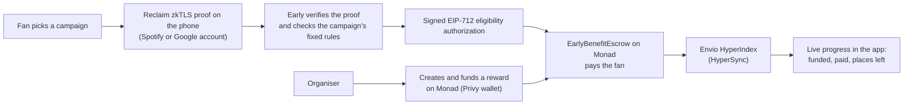

# Early

**Proof you were there first.**

Early lets fans prove they were early to an artist, creator or brand before everyone else, using their real Spotify and YouTube activity. Artists, creators and brands can then reward their real day ones onchain on Monad.

- **Live app:** [proveearly.xyz](https://www.proveearly.xyz) (Monad testnet)
- **Demo video :** [watch here](https://drive.google.com/file/d/1lWnjAC7gLBEO_EQO9YKGN_HR7GRtny20/view?usp=drive_link)
- **Launch video:** [watch on X](https://x.com/proveearly/status/2110167868507623851)
- **Escrow contract (Monad testnet):** [`0x32192Beb858561c67CCe7C1b2dbdD60E8484Df41`](https://testnet.monadvision.com/address/0x32192Beb858561c67CCe7C1b2dbdD60E8484Df41)
- **Hackathon track:** Social, Attention & Culture

---

## Why Early exists

Culture moves because of taste. Before a song charts or a creator blows up, a small group of people found it first: they saved the song, subscribed to the channel, or liked the video before the crowd arrived.

Artists already try to reward these people. They post things like "show me this video at my first concert for free entry", "drop your oldest stream" or "claim the OG pass in the comments". None of it can be checked. Screenshots can be edited, anyone can comment "I was here first", and bots and resellers take the perks that were meant for real fans.

The real record exists. Spotify knows when you saved a song, and Google knows when you liked a video. But that record is locked inside the platforms. Fans can't carry it with them, and small artists can't get it: since May 2025 Spotify only grants full API access to registered businesses with at least 250,000 monthly users.

**There is no trusted registry of who was there before the crowd. Early is that registry, and the fan holds it.**

## What it does

| For | Value |
| --- | --- |
| **Fans** | Your taste finally counts. A dated, verified record of what you backed early can unlock presale access, merch drops, backstage spots or onchain rewards, and you can reuse it across campaigns. |
| **Artists** | Know your real day ones. Set a rule like "saved my song before release" and reward only the people who meet it. |
| **Creators** | Find who subscribed when you had 200 subscribers, and put them first in line for every drop. |
| **Brands** | Loyalty you can verify. Give founding perks to real early customers instead of coupons anyone can claim. |

Fans reveal one statement and nothing else. Early never sees passwords, cookies or the rest of the account history, and the platforms don't need to cooperate.

## How it works



1. **The organiser creates a campaign.** It is a fixed rule (for example "liked this exact video before 27 Oct 2026, 21:00 UTC") with a reward per fan, a capacity and an expiry. The rule is hashed. The organiser funds the reward in the Monad escrow up front, so fans can see the money is real before they spend time proving.
2. **The fan proves the activity.** Early creates a Reclaim Verifier request. On their phone, the fan signs in to Spotify or Google inside Reclaim's zkTLS session. Only the fields the rule needs leave the phone, such as the track or video ID, the channel and the date.
3. **Early checks the rule.** The proof is verified server-side and normalised into a support record. Each source account (a Google or Spotify account) is bound to only one Early account, using a keyed source nullifier. If the record satisfies the rule, Early signs an expiring EIP-712 authorization for that fan's wallet.
4. **The fan claims on Monad.** The escrow checks the signature, the rule hash and version, the amount, both expiries and the signer epoch, then pays the fan. It refuses a second claim from the same wallet or the same source account for that reward.
5. **Everyone sees the same numbers.** Envio indexes every funding, claim and refund event. The app shows funded, paid and remaining amounts and places left, and links every transaction to the Monad explorer.

## What is live

| Proof route | What it proves | Status |
| --- | --- | --- |
| Spotify saved song | A track is in the fan's saved library, with the date it was saved | Live, accepted from phone to server |
| YouTube channel subscription | The fan subscribes to a channel | Live, accepted from phone to server |
| YouTube exact-video like | The fan liked a specific video, with the date of the like | Live, accepted from phone to server, and paid out on Monad |

**Launch campaign: Proof of Rickroll.** Prove you liked the internet's most famous prank before the cutoff and claim 0.01 test MON. The full path ran live on Monad testnet: phone proof → signed authorization → escrow payout → indexed receipt. The first claim is transaction [`0x94d3ce56…a0ad97c`](https://testnet.monadvision.com/tx/0x94d3ce569ae218196b8708e9fdaaf1618c38661986a8bc0b26277a6ada0ad97c).

**Known limits, stated plainly:**

- The YouTube like route reads the first page of Google My Activity likes, which holds recent likes. Today it proves "liked before a cutoff", not the date of a like from years ago. Paging through older history is the next piece of work.
- Spotify recipes page through up to 100 pages of a library.
- Rewards are test MON with no monetary value.

## Try it (judges and testers)

No private access is needed to test the fan flow. Anyone can do this on the live app:

1. Get some test MON for the claim's gas from the [Monad faucet](https://faucet.monad.xyz). The app has a "Copy address" button to make this easier.
2. Install **Reclaim Verifier** on your phone (App Store or Google Play).
3. On YouTube, like the [Proof of Rickroll video](https://www.youtube.com/watch?v=dQw4w9WgXcQ) with your Google account.
4. Open [proveearly.xyz](https://www.proveearly.xyz), sign in (email, Google, X or a wallet), go to **Discover** and open **Proof of Rickroll**.
5. Choose **YouTube · Liked this video**, agree to share only that result, and scan the QR code with your phone. Reclaim proves the like inside a private zkTLS session.
6. Back on the desktop the campaign says **You qualify**. Click **Claim reward**, tick "Pay claim gas with my test MON", and approve the transaction.
7. Follow the **View on Monad explorer** link to see the claim, and watch the reward's places left update through Envio.

Notes: each Google account and each wallet can claim a reward only once. The campaign accepts likes made before 27 Oct 2026, 21:00 UTC. The organiser workspace (`/rewards`), where campaigns are created and funded, is limited to approved partners. Organiser access for judges is available on request through the contact on the site.

## Monad integration

**Why Monad.** Early pays many small rewards: one per verified fan. That only works if each payout is fast and cheap enough to be worth sending, and if fans see the result in seconds instead of waiting. Monad's fast blocks and low fees make a one-cent reward per fan practical. Its EVM compatibility let us use audited OpenZeppelin primitives, Foundry and the existing wallet and indexer tooling unchanged.

| Item | Value |
| --- | --- |
| Network | Monad testnet (chain ID 10143) |
| Contract | `EarlyBenefitEscrow` at [`0x32192Beb858561c67CCe7C1b2dbdD60E8484Df41`](https://testnet.monadvision.com/address/0x32192Beb858561c67CCe7C1b2dbdD60E8484Df41) |
| Deployment transaction | [`0xff359958…941574f41`](https://testnet.monadvision.com/tx/0xff3599589f6a3271311fcf76b197a2d7c7f2e775b66ddbc34ee7373941574f41), block 70207421 |
| Eligibility signer | `0xD4012E36561E4cEaf897FdF18a4C3613D2Bbb14C` |
| Example claim | [`0x94d3ce56…a0ad97c`](https://testnet.monadvision.com/tx/0x94d3ce569ae218196b8708e9fdaaf1618c38661986a8bc0b26277a6ada0ad97c) |
| Deployment record | [`contracts/monad/deployments/10143.json`](contracts/monad/deployments/10143.json) |

**What the escrow guarantees** ([`contracts/monad/src/EarlyBenefitEscrow.sol`](contracts/monad/src/EarlyBenefitEscrow.sol)):

- `createBenefit(payout, capacity, expiry, ruleHash, ruleVersion)` fixes the terms. The creator cannot change payout, capacity or rules afterwards, or cancel an open window.
- `fund(id)` deposits native MON. Liabilities are tracked per reward, and the admin cannot withdraw creator funds.
- `claim(authorization, signature)` pays only with a valid EIP-712 signature from the current eligibility signer. It pays each wallet and each source account at most once per reward, and never beyond capacity or the funded balance.
- `close(id)` refunds the remaining balance to the creator only after the reward expires.
- Rotating the signer increments an epoch and invalidates every pending authorization. Ownership transfer needs acceptance, and renouncing ownership is disabled.

## Privy integration

- **Sign-in and embedded wallets.** Fans sign in with email, Google, X or an existing wallet. Privy creates an embedded wallet on login for anyone without one, with Monad testnet as the default chain. A music fan with no crypto experience goes from sign-in to a wallet that can receive rewards, with nothing to install.
- **Server-side identity on every sensitive action.** Every sensitive API route verifies the Privy access token. It then checks that the wallet named in the request is linked to that Privy account ([`src/lib/privy-server.ts`](src/lib/privy-server.ts)). This covers starting a Reclaim session, saving a support record and preparing a claim. A proof can only be bound to a wallet its owner controls.
- **Onchain actions.** Organisers create and fund rewards, and fans claim them, through the Privy wallet. The app shows progress for each step and links every transaction to the explorer.
- **Gas sponsorship, done safely.** Claims from the embedded wallet can request sponsored gas through Privy. Before a sponsored send, Early checks that the transaction targets the Early escrow on chain 10143, calls `claim`, sends no value, names the user's own wallet as beneficiary and hasn't expired ([`src/lib/early/sponsored-claim.ts`](src/lib/early/sponsored-claim.ts)). If sponsorship is unavailable, Early never quietly falls back to charging the user. Paying gas is an explicit choice.

## Envio integration (HyperIndex + HyperSync)

A HyperIndex indexer ([`indexer/monad`](indexer/monad)) runs on Envio Cloud against the escrow. It syncs through Monad testnet HyperSync (`https://10143.hypersync.xyz`), with RPC as a fallback, and has `rollback_on_reorg` enabled. It indexes `BenefitCreated`, `BenefitFunded`, `BenefitClaimed` and `BenefitClosed` into the `Benefit`, `Claim`, `Creator` and `IndexedEvent` entities. The app reads them over GraphQL ([`src/lib/early/indexed.ts`](src/lib/early/indexed.ts)), and they drive these features:

- **"Places left" on every campaign page.** It is computed from the indexed capacity, claims and remaining balance, so fans know a reward is still live before they prove.
- **The organiser dashboard.** Funded, paid, remaining and refunded totals per reward, and a claim list with beneficiary, amount and transaction hash.
- **Creator totals across all rewards.**
- **Reorg-safe receipts.** After a transaction, Early fetches the canonical receipt from Monad RPC, decodes the escrow event, and checks that Envio indexed the same event with the same block hash. Only then does the app report "up to date". The contract, not the indexer, decides what can be paid, so a stale indexer can never authorize spending.

## Architecture

```text
Phone (Reclaim Verifier)          Browser (Next.js + Privy)               Monad testnet
  zkTLS session on Spotify /  ──►  /dashboard  fan campaigns,        ──►  EarlyBenefitEscrow
  Google; reveals only the         proofs, claims                          (create, fund,
  fields the rule needs            /rewards    organiser workspace         claim, close)
                                         │                                     │
                                         ▼                                     ▼
                                  Next.js API routes                    Envio HyperIndex
                                  · Privy token + wallet check          (HyperSync, GraphQL)
                                  · Reclaim proof verification                 │
                                  · rule evaluation, source nullifiers         │
                                  · EIP-712 eligibility signing  ◄─────────────┘
                                         │                         receipt reconciliation
                                         ▼
                                  Supabase (Postgres)
                                  support records, rules, campaigns,
                                  partners, encrypted short-lived raw proofs
```

## Technology stack

- **App:** Next.js 16, React, TypeScript, CSS modules, framer-motion, GSAP, Lenis
- **Identity and wallets:** Privy (`@privy-io/react-auth`, `@privy-io/node`)
- **Proofs:** Reclaim Protocol zkTLS (`@reclaimprotocol/js-sdk`), with custom provider recipes for Spotify saved tracks, YouTube subscriptions and YouTube likes
- **Chain:** Monad testnet, Solidity 0.8.27, Foundry, OpenZeppelin 5.4.0, ethers v6
- **Indexing:** Envio HyperIndex 3.14 with HyperSync
- **Data:** Supabase (Postgres via PostgREST)
- **Testing:** Vitest, Forge, Playwright

## Repository layout

```text
src/
  app/dashboard/            Fan experience: campaigns, proofs, support records
  app/rewards/              Organiser workspace: rules, rewards, funding, claims
  app/developers/docs/      Developer reference (providers, API, errors, integrity)
  app/api/early/            Early API: proofs, rules, eligibility, claims, reconciliation
  app/api/reclaim/          Reclaim session start and callbacks
  lib/early/                Rules, verification, signing, nullifiers, chain, indexer client
  lib/privy-server.ts       Privy token verification and linked-wallet checks
contracts/monad/            EarlyBenefitEscrow (Foundry), deploy script, tests, deployment record
indexer/monad/              Envio HyperIndex config, schema and handlers
scripts/                    Setup, partner access, ABI export, provider recipe labs
supabase/                   SQL migrations
tests/                      Vitest unit and integration tests, Playwright e2e
contracts/base, contracts/zama-private-receipt, archive/   Earlier, inactive versions (see below)
```

## Run it locally

### Requirements

- Node.js 22 or newer and pnpm 9
- Foundry 1.8 or newer (for contract tests)
- Docker (only to run the indexer locally)
- Accounts: a Supabase project, a Privy app and a Reclaim app. For on-chain actions, a Monad testnet wallet with test MON from the [Monad faucet](https://faucet.monad.xyz).

### 1. Install and configure

```bash
pnpm install
cp .env.example .env.local
```

Fill in `.env.local`. The Reclaim provider IDs and versions for Spotify and YouTube, and the Monad RPC and explorer URLs, are already set in `.env.example`. You need to add:

| Group | Variables |
| --- | --- |
| Reclaim | `RECLAIM_APP_ID`, `RECLAIM_APP_SECRET` |
| Privy | `NEXT_PUBLIC_PRIVY_APP_ID`, `PRIVY_APP_ID`, `PRIVY_APP_SECRET` (optionally `PRIVY_JWT_VERIFICATION_KEY`) |
| Supabase | `SUPABASE_URL`, `SUPABASE_SERVICE_ROLE_KEY` |
| App | `NEXT_PUBLIC_APP_URL`, `ALLOWED_APP_ORIGINS`, `RAW_PROOF_ENCRYPTION_KEY` |
| Monad | `NEXT_PUBLIC_MONAD_ESCROW_ADDRESS` (use `0x32192Beb858561c67CCe7C1b2dbdD60E8484Df41` or your own deployment), `MONAD_ESCROW_DEPLOYMENT_BLOCK` |
| Envio | `ENVIO_GRAPHQL_URL`, plus `ENVIO_GRAPHQL_AUTH_HEADER` and `ENVIO_GRAPHQL_AUTH_TOKEN` if your endpoint needs them |

Then generate the local signer and nullifier secrets:

```bash
node scripts/setup-early-local.mjs
```

This fills `EARLY_SOURCE_NULLIFIER_SECRET`, `EARLY_ELIGIBILITY_PRIVATE_KEY`, `EARLY_ELIGIBILITY_SIGNER_ADDRESS` and `EARLY_ELIGIBILITY_SIGNER_MODE=local-testnet` if they are empty. It never prints key values.

> If you use the deployed escrow, claims only succeed when they are signed by its eligibility signer (`0xD401…B14C`). To test claims end to end with your own signer, deploy your own escrow (see below) and set its address.

Server secrets (Reclaim secret, Supabase service role, Privy secret, signer key, encryption key) must never use the `NEXT_PUBLIC_` prefix.

### 2. Create the database

Apply the migrations in `supabase/` to your project, in this order, using the Supabase SQL editor or `psql`:

1. `v2_verified_discovery.sql`
2. `early_monad_v3.sql`
3. `early_partner_access_v4.sql`
4. `early_campaign_publication_v5.sql`
5. `early_sponsored_receipts_v6.sql`
6. `early_youtube_like_v6.sql`

### 3. Start the app

```bash
pnpm dev
```

Open `http://localhost:3000`. Sign in with Privy, open **Discover**, pick a campaign, scan the QR code with your phone and complete the proof in Reclaim Verifier.

### 4. Give yourself organiser access

Creating campaigns requires an approved organiser. Sign in once, copy your Privy user ID, then run:

```bash
node scripts/early-partner-access.mjs team <privy-user-id> --apply
```

Without `--apply` the script only shows what it would change. Then open `/rewards` to create a rule, publish it, create a reward on Monad and fund it.

### 5. Contracts

```bash
pnpm test:monad            # Forge tests for EarlyBenefitEscrow
pnpm export:monad          # export the ABI used by the app and indexer
```

To deploy your own escrow, follow [`contracts/monad/README.md`](contracts/monad/README.md). Run `forge script` with an encrypted keystore, then record the deployment with `node scripts/record-monad-deployment.mjs <tx-hash>`.

### 6. Indexer

```bash
pnpm --dir indexer/monad install
pnpm check:indexer                 # codegen + typecheck
pnpm --dir indexer/monad test      # handler tests on simulated events
pnpm --dir indexer/monad dev       # local indexer (needs Docker and a deployed escrow in .env.local)
```

For Envio Cloud, point the service at `indexer/monad` with `config.hosted.yaml`, then set `ENVIO_GRAPHQL_URL` to the endpoint it reports. See [`indexer/monad/README.md`](indexer/monad/README.md).

### 7. Checks

```bash
pnpm lint
pnpm typecheck
pnpm test:app
pnpm build
```

## Built during the hackathon, and what came before

Early is a long-term idea I started before this hackathon, and one I intend to grow into a real product. The repository began in June 2026, and its history before September shows an earlier version: a public receipt registry on Base and a private FHE vault on Zama, both built around proving activity on X. That version proved the idea could work, but it was not a product people would use.

Between 1 September and 13 October 2026 I rebuilt Early around Monad and around the people it serves. Everything that makes the submitted product work was built in that window:

**Built during the hackathon (Oct 2026 commits)**

- The `EarlyBenefitEscrow` contract, its Forge tests and its Monad testnet deployment
- The Envio HyperIndex indexer with HyperSync, the hosted deployment, and reorg-safe receipt reconciliation
- The Spotify saved-song, YouTube subscription and YouTube exact-video-like proof recipes
- Rules with hashed, immutable terms; source-account binding with keyed nullifiers; EIP-712 eligibility signing
- The fan experience: campaign discovery, guided proofs, support records, claiming
- The organiser workspace: rules, publication, partner access, reward creation, funding, refunds and recovery of earlier transactions
- Privy gas sponsorship with strict transaction checks, and the explicit self-pay option
- The redesigned public site, developer reference, privacy pages and security headers

**Pre-existing foundation (before 1 September 2026)**

- The Next.js application shell and Privy sign-in
- The first Reclaim integration and proof model, built for X
- Base registry and Zama vault contracts (`contracts/base`, `contracts/zama-private-receipt`) and the Stellar V1 archive. These are inactive in this submission and are kept for history only.
- The first Supabase schema (`supabase/v2_verified_discovery.sql`)

## AI tools

Early's architecture, contracts, proof recipes and security model were designed and built by hand. AI was used where it saves time rather than where it makes decisions: Claude (Anthropic) helped with repetitive code, test scaffolding and documentation, and frontend polish used design skills such as Impeccable and Taste (design-taste-frontend) to refine layout, typography and states. Every AI-assisted change was reviewed, and every flow shown in the demo was tested live by me.

## Attribution

Early is built on open-source software and services. Key dependencies:

- [Next.js](https://nextjs.org) and [React](https://react.dev) (MIT)
- [Privy](https://privy.io): `@privy-io/react-auth`, `@privy-io/node`
- [Reclaim Protocol](https://reclaimprotocol.org): `@reclaimprotocol/js-sdk`
- [OpenZeppelin Contracts](https://github.com/OpenZeppelin/openzeppelin-contracts) 5.4.0 (MIT)
- [Foundry](https://github.com/foundry-rs/foundry) (MIT / Apache-2.0)
- [Envio HyperIndex](https://envio.dev)
- [ethers](https://github.com/ethers-io/ethers.js) (MIT)
- [Supabase](https://supabase.com)
- [framer-motion](https://github.com/motiondivision/motion), [GSAP](https://gsap.com), [Lenis](https://github.com/darkroomengineering/lenis), [lucide-react](https://lucide.dev), [qrcode.react](https://github.com/zpao/qrcode.react), [Geist](https://vercel.com/font)

Each dependency keeps its own license. Proof of Rickroll is an independent demo and is not affiliated with or endorsed by Rick Astley or YouTube.

## What's next

1. **Deeper history:** page through YouTube My Activity, so fans can prove when they liked something years ago, not only recently.
2. **Automatic tiers:** one campaign page, where Early picks the best reward from the date of the proof.
3. **Brand and artist pilots,** starting with our first brand pilot with MiniSend, then East African artists and brands.
4. **An SDK and API** so any app can check a fan's record before granting a presale, a role or an allowlist spot.
5. **The "Early to Early" OG pass** for the first people who use Early.

## License

Early first-party source is licensed under the [Apache License 2.0](LICENSE). Dependencies keep their own licenses.
